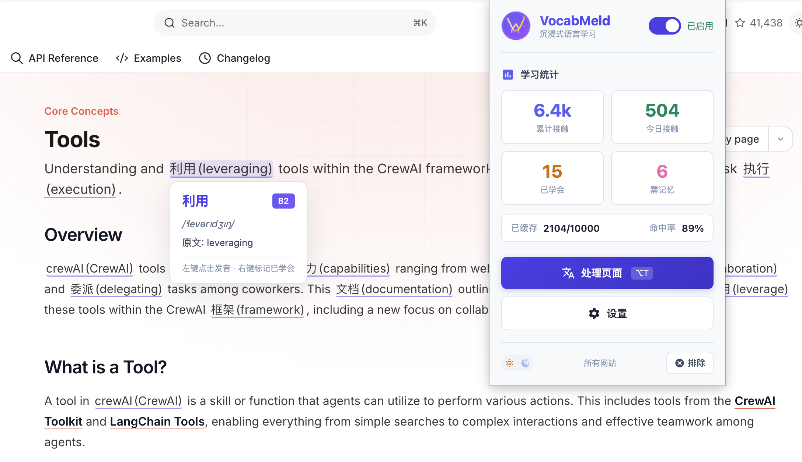

# VocabMeld - Immersive Language Learning Chrome Extension

<p align="center">
  
</p>

<p align="center">
  <strong>Smart vocabulary replacement for immersive bilingual learning</strong><br>
  <sub>Based on "Comprehensible Input" theory, integrate language learning into daily browsing</sub>
</p>

<p align="center">
  English | <a href="README.md">中文</a>
</p>

<p align="center">
  
</p>

---

> To ensure code quality, this project was developed entirely using **Claude Opus 4.5**, with API costs exceeding **$100+** so far. If you find this project helpful, please consider supporting via the donation link at the bottom. Your support keeps this project going! ⭐

---

## ✨ Key Features

- **Multi-LLM Support** — Compatible with OpenAI, DeepSeek, Qwen, Groq, Ollama and more
- **CEFR Difficulty Range** — Filter any A1-C2 band to skip words that are too easy or too hard
- **Smart Caching** — LRU cache (up to 10,000 words), millisecond response on revisits
- **Bidirectional Translation** — Auto-detect page language, smart translation direction
- **Vocabulary Management** — Learned words won't be replaced, memorize list for review
- **Theme Customization** — Dark/Light mode, multiple color schemes

---

## 🚀 Quick Start

### Installation

#### Chrome

1. Open Chrome, navigate to `chrome://extensions/`
2. Enable "Developer mode"
3. Click "Load unpacked" and select this project folder

#### Safari

1. Run in terminal: `xcrun safari-web-extension-converter <project-folder>`
2. The command generates a new project folder and opens Xcode automatically
3. Run one Build in Xcode (`⌘B`)
4. Open Safari → Settings → Developer, then check "Allow unsigned extensions"

### API Configuration

1. Click the extension icon → Settings
2. Choose a preset service (DeepSeek recommended) or custom configuration
3. Enter your API key and test the connection

Configuration exports omit API keys by default. Re-enter them after importing, or explicitly include them and keep the backup secure.

### Supported API Services

| Provider | Endpoint | Example Model |
|----------|----------|---------------|
| DeepSeek | `https://api.deepseek.com/chat/completions` | deepseek-chat |
| OpenAI | `https://api.openai.com/v1/chat/completions` | gpt-4o-mini |
| Qwen | `https://dashscope.aliyuncs.com/compatible-mode/v1/chat/completions` | qwen-plus |
| Groq | `https://api.groq.com/openai/v1/chat/completions` | llama-3.1-8b-instant |
| Ollama | `http://localhost:11434/v1/chat/completions` | qwen2.5:7b |

---

## 📖 Usage Tips

| Action | Description |
|--------|-------------|
| `Alt+T` | Quick process current page |
| Hover on word | View phonetics, difficulty, dictionary definition |
| Click phonetics | Play pronunciation |
| Click "Learned" | Word won't be replaced again |
| Click "Memorize" | Add to memorize list |
| Select text | Add to memorize list |

**Recommended Setup**: Native Chinese + Learning English + B1 difficulty + Medium intensity

---

## 🔧 Features Overview

### Replacement Intensity

| Intensity | Max per Paragraph | Use Case |
|-----------|-------------------|----------|
| Low | 4 words | Light learning, maintain reading flow |
| Medium | 8 words | Daily learning, balance reading and learning |
| High | 14 words | Intensive learning, maximize vocabulary exposure |

### Display Styles

| Style | Format |
|-------|--------|
| Translation(Original) | `translated(original)` — Default |
| Translation Only | `translated` — Hover to see original |
| Original(Translation) | `original(translated)` |

### Site Rules

- **All Sites Mode**: Run on all websites by default, with exclusion list
- **Specified Sites Only**: Only run on designated websites
- Supports domain fuzzy matching, quick toggle in Popup

---

## 🔒 Privacy Policy

- **Local Storage**: All data stored locally in browser, no server uploads
- **API Requests**: Only send text snippets to your configured AI service during translation
- **You're in Control**: API keys provided and managed by you
- **No Tracking**: No analytics, tracking, or advertising code

---

## 📚 Documentation

- [Technical Documentation](TECHNICAL.md) — Architecture, algorithms, development guide

---

## ☕ Support

This project is fully open source, If it helps you, consider supporting!

<p align="center">
  
</p>

---

## 📈 Star History

[](https://star-history.com/#lzskyline/VocabMeld&Date)

---

## 📄 License

This project is open source under the [MIT License](LICENSE).

You are free to use, copy, modify, and distribute this project, including for commercial purposes. The only requirement is to retain the original copyright notice and license.

If you've built upon this project, feel free to attribute:

```
Based on VocabMeld (https://github.com/lzskyline/VocabMeld)
```
